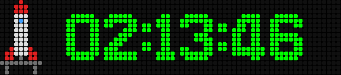
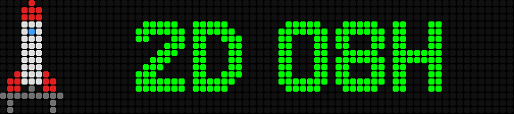
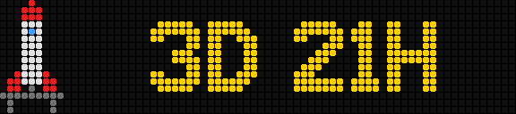
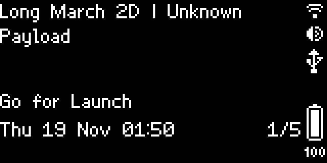
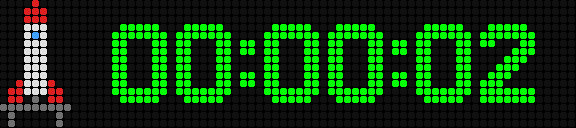
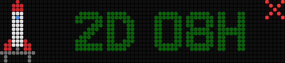
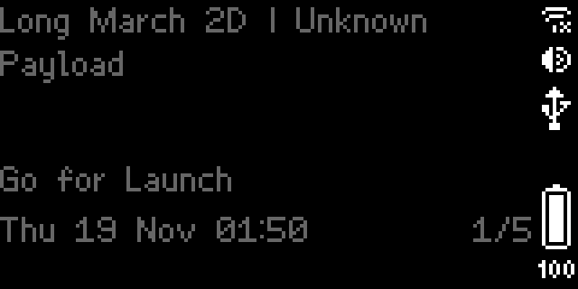

# Launch Countdown

Countdown to the next rocket launch.



The front display counts down to the next rocket launch anywhere in the world, the back display says which mission it is and when it flies. Turn the wheel to look at the launches after it, up to five; at T-0 the rocket on the display lifts off. Nothing to set up: it needs only the bar's Wi-Fi.

A JavaScript app for [BUSY Bar](https://busy.app).

## What the bar shows

The front display shows a rocket on its launch pad and the time to liftoff in large digits. Under a day it counts hours, minutes and seconds and changes every second.

A launch more than a day away is counted in days and hours, such as `2D 08H`, which change on the hour.



The color of the countdown follows the launch status: green for Go, yellow for TBC and TBD, red for Hold, white for any other. The wheel steps through the next launches, up to five; here the third of them, still to be confirmed.



The back display shows the mission's name on up to three lines, its status, the launch date and time on the BUSY Bar's clock, and which of the launches it is, such as `1/5`.



At T-0 the rocket lifts off the pad on its flame with a roar and flies off the top, and the next launch takes its place. A launch that reaches T-0 while another is shown lifts off when the wheel comes back to it.



Until the first answer the front display shows `--`. When a request fails, the app keeps counting down to the launches of the last good answer: the countdown and the back display are dimmed, and a red cross is in the top right corner.





Without a connection and with no launches kept from earlier, the front display shows `--` with the red cross.


## Buttons

| Button | What it does |
| --- | --- |
| Wheel | Steps through the next launches, up to five. |
| Back | Leaves the app. |

## Data

[The Space Devs Launch Library 2](https://thespacedevs.com/llapi), the next five launches, no key needed, polled every 15 minutes. A launch already past T-0 when it arrives is left out. The launches of the last good answer are kept on the bar for a start without a connection.

## Build

Node 24 and npm:

```sh
npm ci
npm run build         # dist/io.github.vvzvlad.launches.tgz
npm run app:install   # install it on a BUSY Bar connected over USB
npm run app:run       # start it
```

## License

[MIT](LICENSE)
